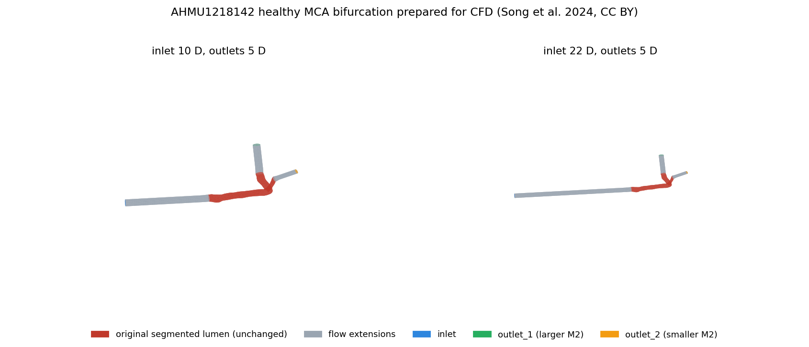

# CFD geometry preparation and verification: AHMU1218142

Source: CMHA healthy-control dataset, Song et al. 2024, *Sci Data* ([Figshare 10.6084/m9.figshare.26965450](https://doi.org/10.6084/m9.figshare.26965450), CC BY). Subject AHMU1218142: M, 55 y. Raw data and prepared STLs stay local in `data/cmha/` (git-ignored). Regenerate with `python3 scripts/cmha_prepare.py AHMU1218142`.

## Prepared geometry

Open ports were extended along their fitted normals, blended to a circle of equal area over one diameter, continued as straight cylinders and capped. Original vertices are untouched.

| Variant | Use | Files (`data/cmha/prepared/AHMU1218142/`) |
|---|---|---|
| inlet 10 D, outlets 5 D | prescribe a **developed (parabolic) inlet profile** | `AHMU1218142_ext_in10D_out5D_mm.stl` (+ `_m.stl` in metres, + one STL per patch) |
| inlet 22 D, outlets 5 D | a **plug inlet** is acceptable: 22 D exceeds the laminar entrance length | `AHMU1218142_ext_in22D_out5D_mm.stl` (same set) |

Patch names: `wall`, `inlet`, `outlet_1` (larger branch), `outlet_2` (smaller branch).

| Port | Diameter (mm) | Extension (10 D variant, mm) | Planarity (RMS / radius) |
|---|---|---|---|
| inlet | 2.789 | 27.9 | 2.0e-05 |
| outlet_1 | 2.619 | 13.1 | 1.7e-05 |
| outlet_2 | 1.752 | 8.8 | 3.0e-05 |

## 1. Geometry verification

| Check | 10 D variant | 22 D variant |
|---|---|---|
| watertight (no boundary edges) | ✅ | ✅ |
| manifold (no edge in > 2 faces) | ✅ | ✅ |
| consistent orientation | ✅ | ✅ |
| outward normals (volume > 0) | ✅ | ✅ |
| original vertices unchanged | ✅ | ✅ |
| volume = original + extensions (±2%) | ✅ | ✅ |
| extensions clear of the vessel | ✅ | ✅ |
| extensions clear of each other | ✅ | ✅ |

Volume: original (flat-capped) 198.7 mm³ + extensions 262.1 mm³ vs. prepared 459.8 mm³ (difference -0.21%, from the transition blend). Extension axes stay ≥ 3.1 port radii from the rest of the vessel. Surface: 20874 triangles (input 8167).

## 2. Input verification against the authors' files

| Check | Value | Reference | Result |
|---|---|---|---|
| Fluent zone `inlet` ↔ our `inlet`: centroid distance; diameter | 0.06 mm; 2.789 mm | 2.781 mm in Fluent | ✅ |
| Fluent zone `outlet1` ↔ our `outlet_1`: centroid distance; diameter | 0.03 mm; 2.619 mm | 2.611 mm in Fluent | ✅ |
| Fluent zone `outlet2` ↔ our `outlet_2`: centroid distance; diameter | 0.07 mm; 1.752 mm | 1.743 mm in Fluent | ✅ |
| Inflow = Fluent inlet velocity × inlet area | 186.2 mL/min | CSV 186.2 mL/min | ✅ |
| Fluent inlet velocity vs. paper's age formula (65.41 − 0.26 × age) | 0.5111 m/s | 0.5111 m/s | ✅ |
| Blood viscosity in the Fluent case | 0.00345 Pa·s | paper states 0.004 Pa·s | ❌ discrepancy, the case file governs |
| Density | 1060 kg/m³ | paper 1060 | ✅ |
| Outlet pressure | 13332, 13332 Pa | paper 13 332 Pa (100 mmHg) | ✅ |
| Steady solver | True | paper: steady | ✅ |
| CSV M1 diameter D | 2.95 mm | our inlet port 2.79 mm | measured at a different site; within 6% |
| CSV 'thicker' branch D1 / 'smaller' D2 | 1.5 / 2.62 mm | our outlets 2.62 / 1.75 mm | labels swapped: D2 is the larger branch |

## 3. Comparison with the reduced-order model (code-to-code, supplementary)

The authors' CFD is another model, not measurement data, so agreement here supports plausibility only. It is not validation (credibility plan, category 7 and the supplementary use of category 5).

* **Flow split** (outlet 1 share): Fluent 0.769; Poiseuille network with equal outlet pressures (branch lengths 12.0 / 12.3 mm from the fitted bifurcation point) 0.837; Murray's law (D³) 0.770. The Poiseuille estimate is higher by 0.068. The 3D model adds junction and curvature losses that favour the smaller branch, which a straight-tube network ignores.
* **Inlet Reynolds number**: ρVD/μ = 438 (laminar). Our engine on the M1 segment gives Re 435 and mean velocity 0.5080 m/s for the same flow. Fluent's 0.5111 m/s is on its 6.073 mm² inlet face; our fitted port is 6.110 mm², which accounts for the 0.6% difference ✅ (flow identical).
* **Entrance length** 0.05·Re·D = 61 mm = 22 D. The original model's inlet segment is only about 16 mm, so with the authors' plug inlet the flow reaching the bifurcation is still developing, and their near-inlet WSS is biased. Hence the two variants above.
* **Mean WSS**: Fluent 11.25 Pa (area average over the whole bifurcation, including the developing inlet); fully developed Poiseuille in M1 5.03 Pa. Not directly comparable; listed for context.

### Same comparison across the dataset

Across 43 controls (outlets matched to the authors' Fluent zones; skipped: AHMU1218113), predicted outlet-1 flow share vs. their CFD (0.640 ± 0.113):

| Estimate | r | Mean error | Mean abs. error | Max abs. error |
|---|---|---|---|---|
| Murray (D³) | 0.85 | +0.017 | 0.051 | 0.141 |
| Poiseuille (D⁴) | 0.84 | +0.056 | 0.078 | 0.203 |
| Poiseuille (D⁴/L) | 0.81 | +0.050 | 0.089 | 0.234 |

Murray's D³ rule tracks the 3D split best: junction and curvature losses in 3D offset the D⁴ advantage of the larger branch. That supports using D³ to split M2 flow if the reduced-order model gains a bifurcation. This is a code-to-code comparison and still needs bench or in vivo confirmation. Matching outlets by zone also explains the earlier negative correlation from the CSV alone: its outlet and branch labels do not correspond.

## 4. Model verification suite

Run alongside this preparation: `python3 -m pytest` (code verification, `tests/test_verification.py`, and model tests) and `python -m bvm verify` ([verification-results.md](verification-results.md)).

## Recommended CFD setup for this geometry

* Fluid: Newtonian, ρ = 1060 kg/m³, μ = 0.0035 Pa·s (this project) or 0.00345 Pa·s (to reproduce the authors).
* Inlet: Q = 186.2 mL/min (authors) or 153 mL/min (MRI population mean). Use a parabolic profile with u_max = 1.022 m/s on the 10 D variant, or a plug at 0.5111 m/s on the 22 D variant.
* Outlets: equal static pressure (authors: 100 mmHg) or resistance outlets for the ischemia scenarios, matching this project's territory boundary condition.
* Wall: rigid, no-slip (the authors' setup); the compliance study is better done in the reduced-order model.
* Mesh: refine the surface first (input edges ≈ 0.2 mm), then check mesh independence by GCI on three meshes (credibility plan, category 8 for model B).
