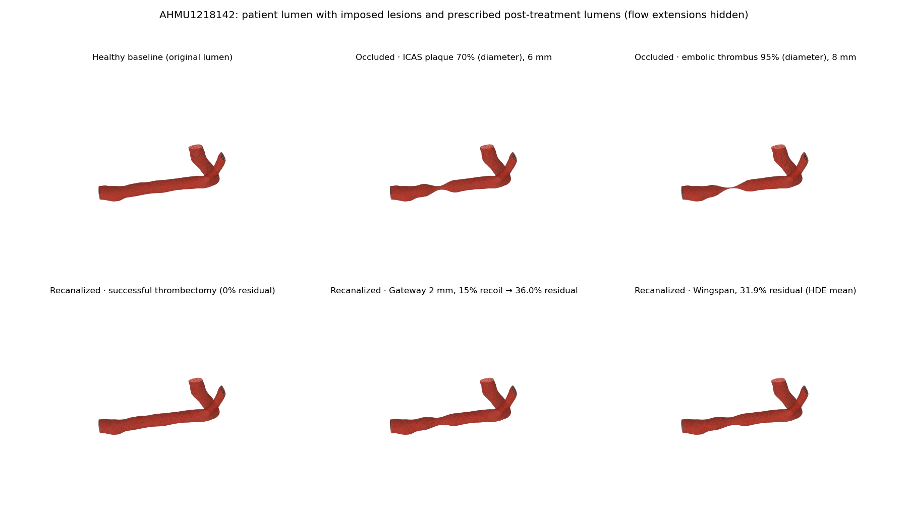

# Occluded and recanalized CFD geometries: AHMU1218142

Built by `python3 scripts/cmha_variants.py AHMU1218142` from the healthy control ([cfd-geometry-AHMU1218142.md](cfd-geometry-AHMU1218142.md)). The STLs are in `data/cmha/prepared/AHMU1218142/variants/<variant>/` (git-ignored). Every variant has the same patches (`wall`, `inlet`, `outlet_1`, `outlet_2`) and extensions (inlet 10 D, outlets 5 D), so the runs differ only in the lesion.

## How the lesions are made

* **Where.** A centerline is marched through the patient's M1 from the inlet port. M1 ends where the section flares into the bifurcation, giving 17.5 mm along the curved centerline. Lesions are centred mid-M1 (s = 8.8 mm), where the local healthy diameter is 2.66 mm.
* **Shape.** The same cosine profile as the reduced-order model: each surface vertex near the lesion moves toward its nearest centerline point by 1 − depth·½(1 + cos πξ). The % is relative to the patient's *local* diameter, so the lumen keeps its own irregular shape, scaled down.
* **What is prescribed, not simulated.** These are lesion and post-treatment *lumens* only, the same assumptions as the app's device panel:
  * thrombus 95% over 8 mm (the app's embolic M1 preset)
  * successful thrombectomy restores the original lumen (residual 0%)
  * Gateway sized to ≤ 80% of the vessel (2 mm) with 15% assumed recoil → 36.0% residual
  * Wingspan residual 31.9% (HDE study mean)

  Device struts, clot fragments, dissection and wall injury are not represented. The 3D CFD will show the hemodynamics of these lumens, not how a device produces them.
* **Not fully occluded.** A 100% occlusion has no flow path, so CFD would return zero flow everywhere. Without collaterals, which this truncated geometry lacks, it is uninformative. 95% is the near-occlusion used instead.

## Verification

| Variant | Watertight, manifold, oriented | Volume check | Extensions clear | No flipped faces | Unchanged outside lesion | Throat / local D (target) |
|---|---|---|---|---|---|---|
| healthy | ✅ | ✅ | ✅ | ✅ | ✅ (0 vertices moved) | — |
| occluded_icas70 | ✅ | ✅ | ✅ | ✅ | ✅ (600 vertices moved) | 0.303 (0.300) ✅ |
| occluded_thrombus95 | ✅ | ✅ | ✅ | ✅ | ✅ (808 vertices moved) | 0.052 (0.050) ✅ |
| recanalized_thrombectomy | ✅ | ✅ | ✅ | ✅ | ✅ (0 vertices moved) | — |
| recanalized_angioplasty | ✅ | ✅ | ✅ | ✅ | ✅ (600 vertices moved) | 0.641 (0.640) ✅ |
| recanalized_stent | ✅ | ✅ | ✅ | ✅ | ✅ (600 vertices moved) | 0.682 (0.681) ✅ |

Throat ratios are measured by slicing the deformed surface perpendicular to the centerline. They are not the requested values, so they test the whole construction. Small differences come from the patient lumen's irregular cross-section and the slice spacing (0.25 mm).

## Reduced-order predictions to check the CFD against

Computed from the *measured* area profile of each STL (Poiseuille along M1 plus the Young–Tsai expansion loss, μ = 0.0035 Pa·s). The territory column uses the app's boundary condition: inlet 85 mmHg, venous 10 mmHg and a distal resistance calibrated so the healthy lumen carries 153 mL/min. Branches and the bifurcation are lumped into that resistance.

| Variant | Throat D (mm) | Distal flow, territory BC | ΔP along M1 at that flow (viscous + expansion), mmHg | ΔP if 153 mL/min were forced (fixed-flow run) | Restored vs. occluded |
|---|---|---|---|---|---|
| healthy | — | 153.0 mL/min (100%) | 0.90 (0.90 + 0.00) | 0.9 mmHg |  |
| occluded_icas70 | 0.78 | 75.3 mL/min (49%) | 38.52 (4.77 + 33.75) | 149 mmHg: exceeds the 75 mmHg available, so do not run fixed-flow |  |
| occluded_thrombus95 | 0.13 | 1.6 mL/min (1%) | 74.20 (51.37 + 22.84) | 2.03e+05 mmHg: exceeds the 75 mmHg available, so do not run fixed-flow |  |
| recanalized_thrombectomy | — | 153.0 mL/min (100%) | 0.90 (0.90 + 0.00) | 0.9 mmHg | 100% of the deficit vs. occluded_thrombus95 |
| recanalized_angioplasty | 1.66 | 146.4 mL/min (96%) | 4.11 (1.46 + 2.65) | 4.4 mmHg | 91% of the deficit vs. occluded_icas70 |
| recanalized_stent | 1.77 | 148.5 mL/min (97%) | 3.09 (1.34 + 1.75) | 3.2 mmHg | 94% of the deficit vs. occluded_icas70 |

When the 3D results come in, compare ΔP across the lesion and the distal flow with this table. Agreement on the healthy and moderate cases, together with a quantified deviation at 95%, where 3D jet and separation losses dominate, is the model-form evidence the credibility plan asks for. Because both are models, this is a code-to-code comparison; bench data from the vessel-mimic flow loop is still the validation.
